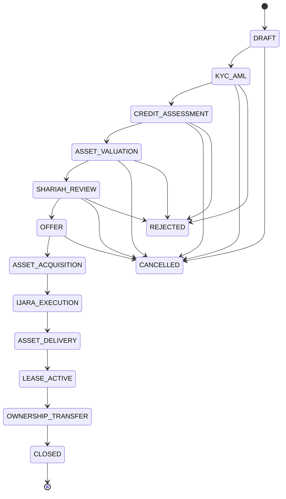

# Ijara Financing Workflow

> Generated from `bayti/ijara/definition.py` by `python -m bayti.ijara docs`. Do not edit by hand; change the definition and regenerate.

Ijara Muntahia Bittamleek is a lease that ends with the customer owning the asset. This workflow moves an application from request to title transfer and blocks every step that lacks its verified documents or approvals.

## Flow

## Rules enforced by the system

- **Documents gate stages.** A stage cannot be left until each of its required documents has been uploaded (or generated) and verified. Re-uploads create a new version; only the latest counts.
- **Maker-checker.** Nobody can verify a document they uploaded, and the stage approver cannot be the person who prepared that stage's documents.
- **Role authority.** Each document type names the role allowed to verify it; each decision stage names its approver role.
- **Ownership before lease.** The ASSET_ACQUISITION stage needs title in the bank's name and a takaful policy before the Ijara agreement can be prepared.
- **Separate promise to transfer.** The promise to transfer ownership is its own document, not a clause of the lease.
- **Rent starts on delivery.** Rent is collected only after the delivery certificate is verified.
- **Ownership transfers after full payment.** LEASE_ACTIVE cannot advance until every rental is paid.
- **Exit.** Applications can be cancelled until the bank buys the asset. After that, an unwind is manual.
- **Audit trail.** Every upload, verification, rejection, approval and stage change is logged with actor and time. Stored files carry a SHA-256 hash.

## Stages

### 1. DRAFT

Capture the request and collect customer documents.

- **Owner:** relationship officer
- **Next stage:** KYC_AML

| Required document | Verified by | Source |
|---|---|---|
| Financing application form (`APPLICATION_FORM`) | relationship officer | Uploaded |
| National ID / passport copy (`NATIONAL_ID`) | compliance officer | Uploaded |
| Salary certificate or income proof (`INCOME_PROOF`) | credit officer | Uploaded |
| Bank statements (last 6 months) (`BANK_STATEMENTS`) | credit officer | Uploaded |

### 2. KYC_AML

Identify the customer and screen for sanctions and AML risk.

- **Owner:** compliance officer
- **Approval by:** compliance officer
- **Next stage:** CREDIT_ASSESSMENT

| Required document | Verified by | Source |
|---|---|---|
| KYC form (`KYC_FORM`) | compliance officer | Uploaded |
| Sanctions / AML screening report (`SANCTIONS_SCREENING`) | compliance officer | Uploaded |
| Source of funds declaration (down payment) (`SOURCE_OF_FUNDS`) | compliance officer | Uploaded |

### 3. CREDIT_ASSESSMENT

Assess creditworthiness and affordability.

- **Owner:** credit officer
- **Approval by:** credit officer
- **Next stage:** ASSET_VALUATION

| Required document | Verified by | Source |
|---|---|---|
| Credit bureau report (`CREDIT_BUREAU_REPORT`) | credit officer | Uploaded |
| Affordability assessment (`AFFORDABILITY_ASSESSMENT`) | credit officer | Uploaded |
| Credit approval memo (`CREDIT_APPROVAL_MEMO`) | credit officer | Uploaded |

### 4. ASSET_VALUATION

Confirm the seller owns the asset and its value supports the price.

- **Owner:** valuation officer
- **Approval by:** valuation officer
- **Next stage:** SHARIAH_REVIEW

| Required document | Verified by | Source |
|---|---|---|
| Title deed / proof of seller ownership (`TITLE_DEED`) | legal officer | Uploaded |
| Independent valuation report (`VALUATION_REPORT`) | valuation officer | Uploaded |
| Seller no-objection / encumbrance clearance (`SELLER_NOC`) | legal officer | Uploaded |

### 5. SHARIAH_REVIEW

Confirm the asset and the deal structure are Shariah compliant.

- **Owner:** shariah officer
- **Approval by:** shariah officer
- **Next stage:** OFFER

| Required document | Verified by | Source |
|---|---|---|
| Shariah compliance checklist (`SHARIAH_CHECKLIST`) | shariah officer | Uploaded |

### 6. OFFER

Issue the offer and obtain the customer's promise to lease.

- **Owner:** legal officer
- **Next stage:** ASSET_ACQUISITION
- **Note:** The promise is a unilateral undertaking; it is not the lease itself.

| Required document | Verified by | Source |
|---|---|---|
| Financing offer letter (`OFFER_LETTER`) | legal officer | Generated from template, then signed |
| Promise to lease (Wa'd) (`PROMISE_TO_LEASE`) | legal officer | Generated from template, then signed |

### 7. ASSET_ACQUISITION

The bank buys the asset and takes ownership and ownership risk.

- **Owner:** operations officer
- **Next stage:** IJARA_EXECUTION
- **Note:** No lease can be signed until the bank owns the asset.

| Required document | Verified by | Source |
|---|---|---|
| Sale and purchase agreement (bank buys from seller) (`SALE_PURCHASE_AGREEMENT`) | legal officer | Uploaded |
| Proof of payment to seller (`SELLER_PAYMENT_PROOF`) | operations officer | Uploaded |
| Title registered in the bank's name (`TITLE_IN_BANK_NAME`) | legal officer | Uploaded |
| Takaful policy (bank as owner/beneficiary) (`TAKAFUL_POLICY`) | operations officer | Uploaded |

### 8. IJARA_EXECUTION

Sign the lease and the separate promise to transfer ownership.

- **Owner:** legal officer
- **Next stage:** ASSET_DELIVERY

| Required document | Verified by | Source |
|---|---|---|
| Ijara (lease) agreement (`IJARA_AGREEMENT`) | legal officer | Generated from template, then signed |
| Promise to transfer ownership (separate undertaking) (`PROMISE_TO_TRANSFER`) | legal officer | Generated from template, then signed |
| Rental schedule (`RENTAL_SCHEDULE`) | operations officer | Generated from template, then signed |

### 9. ASSET_DELIVERY

Hand the asset to the customer; rent starts on delivery.

- **Owner:** operations officer
- **Next stage:** LEASE_ACTIVE

| Required document | Verified by | Source |
|---|---|---|
| Delivery and acceptance certificate (`DELIVERY_CERTIFICATE`) | operations officer | Generated from template, then signed |

### 10. LEASE_ACTIVE

Lease term: collect rent and service the asset.

- **Owner:** operations officer
- **Next stage:** OWNERSHIP_TRANSFER
- **Note:** Late-payment amounts, if any, go to charity, not to bank income.

### 11. OWNERSHIP_TRANSFER

Transfer title to the customer at the end of the lease.

- **Owner:** legal officer
- **Next stage:** CLOSED

| Required document | Verified by | Source |
|---|---|---|
| Final settlement statement (`FINAL_SETTLEMENT_STATEMENT`) | operations officer | Uploaded |
| Ownership transfer deed (gift or sale) (`TRANSFER_DEED`) | legal officer | Generated from template, then signed |
| Title registered in the customer's name (`TITLE_IN_CUSTOMER_NAME`) | legal officer | Uploaded |

### 12. CLOSED

Financing completed.

- **Owner:** operations officer
- **Next stage:** none (end of workflow)

## Stage-specific checks

| Stage | Check |
|---|---|
| CREDIT_ASSESSMENT | Monthly rental must not exceed the policy share of monthly income (default 50%). |
| ASSET_VALUATION | An independent valuation must be recorded by someone other than the approver, and the purchase price must not exceed the policy share of that valuation (default 100%). |
| LEASE_ACTIVE | All rentals paid before ownership transfer. |

Policy defaults live in `Policy` in `bayti/ijara/engine.py` and are placeholders until set from the bank's approved credit policy.

## Generated documents

Templates are in `bayti/ijara/templates/`. They are **drafts**: Legal and the Shariah Supervisory Board must approve the final wording before customer use.

- Financing offer letter: `offer_letter.md.tmpl`
- Promise to lease (Wa'd): `promise_to_lease.md.tmpl`
- Ijara (lease) agreement: `ijara_agreement.md.tmpl`
- Promise to transfer ownership (separate undertaking): `promise_to_transfer.md.tmpl`
- Rental schedule: `rental_schedule.md.tmpl`
- Delivery and acceptance certificate: `delivery_certificate.md.tmpl`
- Ownership transfer deed (gift or sale): `transfer_deed.md.tmpl`
